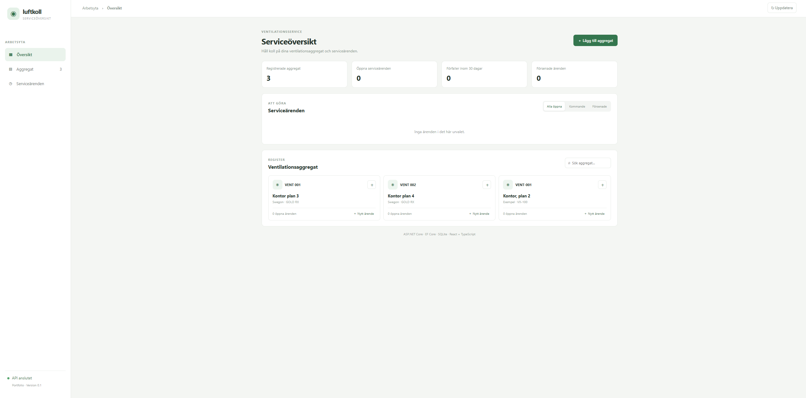

# Ventilationsservice

Ett litet portfolio-projekt för att registrera ventilationsaggregat och följa deras serviceärenden. Projektet använder fiktiva exempeldata.

## Skärmbild



## Teknik

- .NET 10 och ASP.NET Core Web API
- Entity Framework Core med SQLite
- xUnit för tester
- React, TypeScript och Vite för webbgränssnittet

## Funktioner

- Registrera, visa, söka och uppdatera aggregat.
- Skapa och uppdatera serviceärenden för ett aggregat.
- Filtrera ärenden som är förfallna eller förfaller inom 30 dagar.
- Markera ett ärende som genomfört och behålla det i servicehistoriken.
- React-vy för att skapa aggregat och serviceärenden, söka aggregat, se serviceöversikt och klarmarkera ärenden.

Ett genomfört serviceärende fungerar som historikpost i den här första versionen. En separat modell för servicebesök kan läggas till senare om projektet behöver skilja mellan planerat arbete och utfört besök.

## Projektstruktur

- `src/Ventilationsservice.Api` innehåller API:t, datamodellerna och databaskonfigurationen.
- `src/Ventilationsservice.Web` innehåller React-gränssnittet.
- `tests/Ventilationsservice.Api.Tests` innehåller tester av regler och controllerbeteenden.

## API i korthet

- `GET /api/units` och `GET /api/units?search=...`
- `GET /api/units/{id}`
- `POST /api/units`
- `PUT /api/units/{id}`
- `GET /api/service-cases?due=overdue`
- `GET /api/service-cases?due=upcoming`
- `GET /api/service-cases?status=Open`
- `POST /api/units/{id}/service-cases`
- `PUT /api/service-cases/{id}`
- `POST /api/service-cases/{id}/complete`

OpenAPI-dokumentet exponeras i utvecklingsläge på `/openapi/v1.json`.

## Köra lokalt

Starta API:t från projektroten i en terminal:

```powershell
dotnet run --project src/Ventilationsservice.Api
```

Installera webbpaketen en gång och starta gränssnittet i en andra terminal:

```powershell
cd src/Ventilationsservice.Web
npm install
npm run dev
```

Öppna adressen som Vite skriver ut, vanligtvis `http://localhost:5173`. Vites utvecklingsproxy skickar `/api`-anrop till API:t på `http://localhost:5116`.

Kör testerna från projektroten:

```powershell
dotnet test
```

## Status

API, EF Core-migration, SQLite-databas och webbgränssnittets grundflöden finns på plats. Frontendens produktionsbygge kan kontrolleras med `npm run build`.


