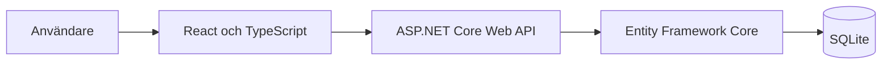

# Ventilationsservice

[](https://github.com/Oskarjohanssons/Ventilationsservice/actions/workflows/ci.yml)

Jag har tidigare erfarenhet inom ventilation och byggde det här projektet för att kombinera den verksamhetskunskapen med systemutveckling i .NET. Appen hjälper en användare att hålla ordning på ventilationsaggregat och deras serviceärenden. All information i demon är fiktiv.

## Lösningens uppbyggnad

Webbgränssnittet anropar ett ASP.NET Core API. API:t använder Entity Framework Core för att läsa och skriva data i SQLite.



Gränssnittet och API:t publiceras tillsammans som en tjänst. API-reglerna testas med xUnit, och GitHub Actions kör projektets automatiska kontroller vid ändringar.

## Skärmbild


## Teknik

- .NET 10 och ASP.NET Core Web API
- Entity Framework Core med SQLite
- xUnit för tester
- React, TypeScript och Vite för webbgränssnittet

## Funktioner

- Registrera, visa, söka och uppdatera aggregat.
- Skapa och uppdatera serviceärenden för ett aggregat.
- Filtrera ärenden som är förfallna eller förfaller inom 30 dagar.
- Markera ett ärende som genomfört och behålla det i servicehistoriken.
- React-vy för att skapa aggregat och serviceärenden, söka aggregat, se serviceöversikt och klarmarkera ärenden.
- Visa varje aggregats servicehistorik med öppna och genomförda ärenden, beskrivningar och datum.
- Välj ett befintligt aggregat i serviceformuläret; listan visar inventarienummer, plats, tillverkare och modell.
- Registrera aggregat med fri text för plats, tillverkare och modell. Formuläret föreslår vanliga tillverkare och produktserier, men accepterar även egna värden.
- Redigera inventarienummer, plats, tillverkare och modell för ett befintligt aggregat.
- Lägg till tydligt fiktiva demoaggregat och serviceärenden automatiskt i en tom databas när demodata är aktiverad.

I utvecklingsmiljö är demodata aktiverad. Tre exempelaggregat och deras serviceärenden läggs till endast om databasen är tom. Befintliga aggregat påverkas inte. För en demo i en annan miljö aktiverar du inställningen `DemoData:Enabled` (miljövariabel: `DemoData__Enabled=true`).

Ett genomfört serviceärende fungerar som historikpost i den här första versionen. En separat modell för servicebesök kan läggas till senare om projektet behöver skilja mellan planerat arbete och utfört besök.

## Projektstruktur

- `src/Ventilationsservice.Api` innehåller API:t, datamodellerna och databaskonfigurationen.
- `src/Ventilationsservice.Web` innehåller React-gränssnittet.
- `tests/Ventilationsservice.Api.Tests` innehåller tester av regler och controllerbeteenden.

## API i korthet

- `GET /api/units` och `GET /api/units?search=...`
- `GET /api/units/{id}`
- `POST /api/units`
- `PUT /api/units/{id}`
- `GET /api/service-cases?due=overdue`
- `GET /api/service-cases?due=upcoming`
- `GET /api/service-cases?status=Open`
- `POST /api/units/{id}/service-cases`
- `PUT /api/service-cases/{id}`
- `POST /api/service-cases/{id}/complete`

OpenAPI-dokumentet exponeras i utvecklingsläge på `/openapi/v1.json`.

## Kostnadsfri demo på Render

Projektet innehåller `Dockerfile` och `render.yaml` för att publicera API:t och React-gränssnittet som en tjänst på Render Free. Blueprinten använder en tillfällig SQLite-databas i `/tmp` och aktiverar fiktiv demodata. Ingen persistent disk eller betalplan krävs.

Render Free stänger av tjänsten efter 15 minuter utan trafik och den första laddningen efter vila kan ta omkring en minut. SQLite-filen försvinner när tjänsten startas om eller vilar; demodata skapas då igen. Ändringar som en besökare gör i demon sparas alltså inte permanent. [Render beskriver begränsningarna för gratistjänster här](https://render.com/docs/free).

För att skapa demon går du till Render, väljer **New → Blueprint**, ansluter GitHub och väljer det här repot. Granska att tjänsten använder **Free**-planen innan du skapar den. Render visar sedan en publik `onrender.com`-adress när bygget är klart.

## Köra lokalt

Starta API:t från projektroten i en terminal:

```powershell
dotnet run --project src/Ventilationsservice.Api
```

Installera webbpaketen en gång och starta gränssnittet i en andra terminal:

```powershell
cd src/Ventilationsservice.Web
npm install
npm run dev
```

Öppna adressen som Vite skriver ut, vanligtvis `http://localhost:5173`. Vites utvecklingsproxy skickar `/api`-anrop till API:t på `http://localhost:5116`.

Kör testerna från projektroten:

```powershell
dotnet test
```

Frontendens automatiserade webbläsartest körs från webbprojektets mapp. Installera Chromium en gång och kör sedan testet:

```powershell
cd src/Ventilationsservice.Web
npm install
npx playwright install chromium
npm run test:e2e
```

End-to-end-testet använder en simulerad API-respons och går igenom formulären i webbgränssnittet. GitHub Actions kör samma test automatiskt vid push och pull request.

## Status

Första versionen innehåller API, EF Core-migration, SQLite-databas, webbgränssnittets huvudflöden och automatiserade kontroller. Projektet är en portfolio-demo med fiktiva data, inte ett produktionssystem för verkliga serviceuppgifter.
